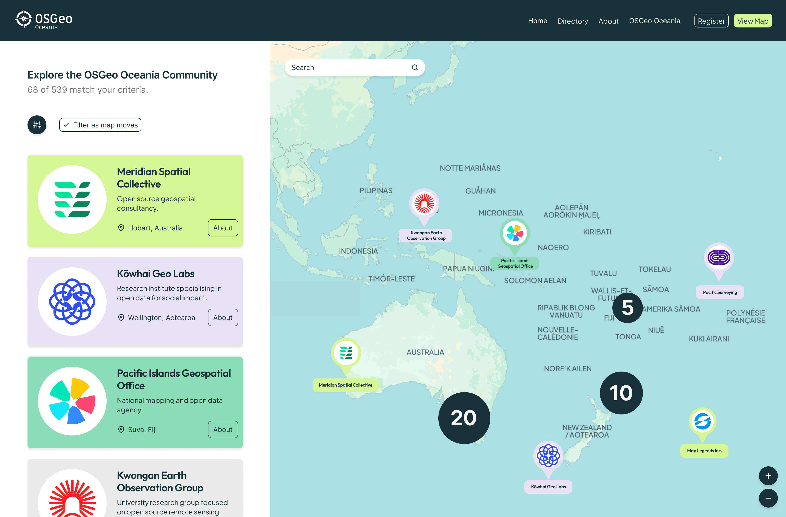

# OSGeo Oceania OSS Capabilities Map



## What is this

An interactive map and directory of the people, projects and organisations
contributing to and building with open source geospatial software. OSGeo
Oceania runs it for its region at
[map.osgeo-oceania.org](https://map.osgeo-oceania.org). This repository is
published so other regional chapters and communities can fork it and run
their own. It is a working implementation to remix: running the sample
directory needs no configuration, but making it your own involves editing
the code, content and assets. It is not a general-purpose directory builder
with an administration interface.

## What you get

- **The directory app**: a Next.js site with a searchable, filterable list
  of listings, a map with clustered pins, a page per listing, a branded
  MapLibre + Protomaps basemap with region-aware country labels, and
  location search.
- **The listing data format**: the app reads one JSON array of listings, either
  hosted at a URL you choose or bundled in the repository. Produce it from
  any CMS, spreadsheet or script, or edit it by hand.
  [docs/FEED.md](docs/FEED.md) documents every field and includes a
  validator.

OSGeo Oceania produces its own feed through a private moderation process;
that implementation is not part of the public release.

Where the listings come from is set by configuration alone:

| Configuration                    | Mode    | Shows                                                 |
| -------------------------------- | ------- | ----------------------------------------------------- |
| `PUBLISHED_SNAPSHOT_URL` set     | hosted  | Your feed, re-fetched about every minute              |
| `data/profiles.json` in the repo | bundled | Your listings, shipped with each build                |
| Neither                          | sample  | Fictional listings under a notice, kept out of search |

Bundled JSON is a supported production option, not just a local one: edit
`data/profiles.json`, run `npm run validate-data`, rebuild and deploy. The
sample data in `data/sample-profiles.json` is fictional, uses example
domains, and is always shown with a notice; `?mode=demo` shows it on any
deployment.

## App pages

| Page                                            | Purpose                                                                                                 |
| ----------------------------------------------- | ------------------------------------------------------------------------------------------------------- |
| `/`                                             | Home page introducing the directory and inviting people to explore it.                                  |
| `/map`                                          | Searchable directory with filters, list/map views and location search.                                  |
| `/map/<slug>-<id>`                              | Listing details, website links and a location mini-map.                                                 |
| `/about`                                        | Background and purpose of the project.                                                                  |
| `/listing-criteria`, `/submission-requirements` | Eligibility and guidance on what a listing should contain.                                              |
| `/submit`, `/feedback`                          | Unconfigured notices in the public release; connect your own forms or contact methods when adapting it. |
| `/terms-and-privacy`                            | Terms, privacy information and data attribution to review for your deployment.                          |

For where these pages and their supporting code live, see the
[codebase map and data flow](docs/architecture.md).

## Try it

Requires Node.js 22 or later.

```bash
npm ci
npm run dev
```

Open <http://localhost:3000/map>. No configuration is needed: the app runs
in sample mode and shows the fictional listings under a notice.

## Adapt it

The name, logo and other marks belong to OSGeo Oceania and must be replaced
when publishing your own directory. There are two kinds of changes:

| Configure without changing app code | How                                                                                                                           |
| ----------------------------------- | ----------------------------------------------------------------------------------------------------------------------------- |
| Listings source                     | Add `data/profiles.json` or set `PUBLISHED_SNAPSHOT_URL`, as described above.                                                 |
| Optional vector basemap             | Set `NEXT_PUBLIC_PROTOMAPS_KEY`; without it, the map uses OpenStreetMap raster tiles.                                         |
| Optional Google Analytics           | Set `NEXT_PUBLIC_GA_ID`, or leave it unset to disable Google Analytics. The public release does not include Vercel Analytics. |

Copy `.env.example` to `.env.local` for local environment settings; set
them through your host for deployment. These settings do not rebrand the
site or change its region.

| Adapt in the code and assets                          | Starting points                                                                                                                                    |
| ----------------------------------------------------- | -------------------------------------------------------------------------------------------------------------------------------------------------- |
| Name, logos, colours and fonts                        | `components/layout/`, `public/`, `app/layout.tsx`, `tailwind.config.ts` and `lib/map/config.ts`.                                                   |
| Site domain, metadata and contact details             | `lib/constants.ts`, `app/layout.tsx`, `lib/seo/schema.ts` and `app/manifest.ts`. The canonical domain is set in code, not an environment variable. |
| Region, map bounds and location search                | `lib/map/config.ts`, `public/data/` and `scripts/build-gazetteer.mjs`.                                                                             |
| Page copy, listing criteria and capability vocabulary | `app/` page files and `lib/data/vocabularies.ts`. Directory filters are derived from your feed.                                                    |
| Submission and feedback forms                         | Add your own form embeds or links in `app/submit/page.tsx` and `app/feedback/page.tsx`.                                                            |
| Privacy terms, analytics and project policies         | `app/terms-and-privacy/page.tsx`, `app/layout.tsx`, `SECURITY.md` and `CONTRIBUTING.md`.                                                           |

The public release starts with unconfigured submission and feedback pages;
it contains no live OSGeo Oceania form links. Add your own forms or contact
methods in those pages, or keep the unconfigured notices. A hosted feed supplies listings to the app; it
does not provide a submission, moderation or publishing workflow. You can
maintain bundled JSON directly, or build your own process to produce a feed.
Google services are not required to run the public app.

[docs/ADAPTING.md](docs/ADAPTING.md) is the full file-by-file checklist,
including asset licences, sample data, regional labels and a final search
for references to replace. Follow it before publishing your fork, alongside
the deployment instructions below.

## Deploy it

[docs/SETUP.md](docs/SETUP.md) covers deployment on a host supporting the
Next.js Node.js runtime, using bundled JSON or a hosted feed. The generic
path is `npm ci`, `npm run build`, then `npm start`. Vercel is an optional
host, with its own instructions; no Vercel account is required.

## Documentation

|                                                                 |                                                                                                             |
| --------------------------------------------------------------- | ----------------------------------------------------------------------------------------------------------- |
| [Data sources and attribution](ASSETS.md#data-shown-on-the-map) | Origins and licences of map data; geographic-file details in [public/data/README.md](public/data/README.md) |
| [docs/FEED.md](docs/FEED.md)                                    | The listings data: modes, every field, and a validator                                                      |
| [docs/ADAPTING.md](docs/ADAPTING.md)                            | Everything to replace for your region, as a checklist                                                       |
| [docs/SETUP.md](docs/SETUP.md)                                  | Deployment: bundled JSON or a hosted feed                                                                   |
| [docs/architecture.md](docs/architecture.md)                    | How the pieces fit, the basemap and country labels, known trade-offs                                        |
| [CONTRIBUTING.md](CONTRIBUTING.md)                              | Forks yes, pull requests no; questions via issues                                                           |
| [SECURITY.md](SECURITY.md)                                      | Reporting a vulnerability                                                                                   |

## Stack

Next.js 15 (App Router) · TypeScript · Tailwind + shadcn/ui · MapLibre GL JS
· Protomaps · Vitest. Deploys to Vercel or any Node.js host.

Releases are tagged.

## AI-assisted development

Generative AI tools (Claude, and OpenAI Codex for release reviews) were
used to assist with development. Project direction and release decisions
remain with the maintainers, who are responsible for the published software
and its maintenance.

## Licence

The code is licensed under the [Apache License 2.0](LICENSE); see also
[NOTICE](NOTICE). Images and data files are licensed separately: see
[ASSETS.md](ASSETS.md). The OSGeo Oceania name, logo and marks are
trademarks and are not covered by the code licence: see
[TRADEMARKS.md](TRADEMARKS.md).

The components in `components/ui/` build on [shadcn/ui](https://ui.shadcn.com)
(MIT).

Made by [Cartisan](https://www.cartisan.io) for OSGeo Oceania.
